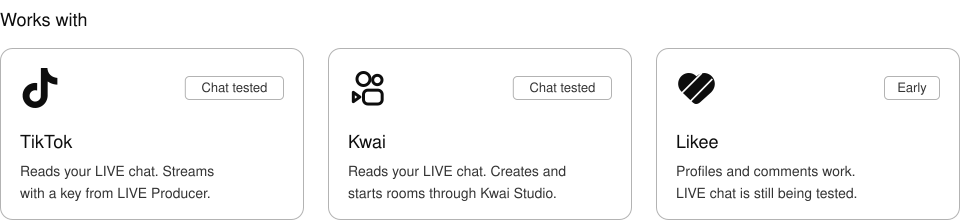
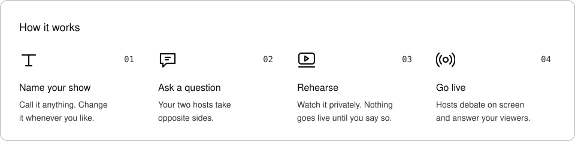
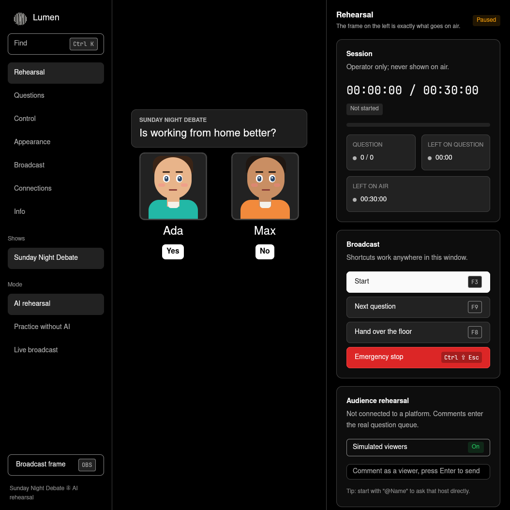
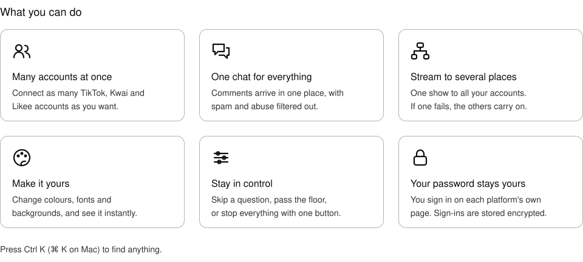

<picture>
  <source media="(prefers-color-scheme: dark)" srcset="assets/readme/hero-dark.svg">
  
</picture>

<p align="center">
  <a href="https://github.com/OnurByte/Lumen/releases/latest"><b>Download</b></a> ⁜ Linux, macOS and Windows
</p>

## Install

### <picture><source media="(prefers-color-scheme: dark)" srcset="assets/readme/os-apple-dark.svg"></picture> <picture><source media="(prefers-color-scheme: dark)" srcset="assets/readme/os-linux-dark.svg"></picture> macOS and Linux

Open **Terminal** and paste:

```sh
curl -fsSL https://raw.githubusercontent.com/OnurByte/Lumen/main/install.sh | sh
```

### <picture><source media="(prefers-color-scheme: dark)" srcset="assets/readme/os-windows-dark.svg"></picture> Windows

Open **PowerShell** and paste:

```powershell
irm https://raw.githubusercontent.com/OnurByte/Lumen/main/install.ps1 | iex
```

Then open **Lumen** from your apps. A short guide helps you set up your first show.

**Updating:** Lumen tells you when a new version is out. Choose **Install update** on the **Info** page.

<picture>
  <source media="(prefers-color-scheme: dark)" srcset="assets/readme/platforms-dark.svg">
  
</picture>

<picture>
  <source media="(prefers-color-scheme: dark)" srcset="assets/readme/steps-dark.svg">
  
</picture>

<p align="center"></p>

<picture>
  <source media="(prefers-color-scheme: dark)" srcset="assets/readme/features-dark.svg">
  
</picture>

## What you need

| To | You need |
| --- | --- |
| Practise | Nothing else. Choose **Practice without AI** |
| Use AI hosts | [Codex](https://github.com/openai/codex), signed in to your ChatGPT account |
| Stream | [OBS Studio](https://obsproject.com), plus permission to go live on your account |

Going live is up to each platform. Kwai, for example, asks for 500 followers and an approved LIVE application. Spoken voice is Turkish for now, so other languages use on-screen captions. [See what has been tested](docs/platforms.md).

---

<details>
<summary><b>Command line</b></summary>

```sh
lumen                     # open the app
lumen rehearse --scripted # practise without AI
lumen shows               # list your shows
lumen status              # see what is running
lumen update              # install the latest version (--rollback undoes it)
lumen info                # version and folders
```

Accounts and streaming: `lumen-live --help`. On Windows, use `lumen-live update` and `lumen-live info`.

</details>

<details>
<summary><b>Privacy and safety</b></summary>

- Your shows and sign-ins stay on your computer, and sign-ins are encrypted. Only the debate text goes to the AI you choose.
- You log in on the platform's own page, so Lumen never handles your password.
- Reading a chat never gives Lumen permission to stream. You authorize each account yourself.
- Hosts are fictional characters and say so if a viewer asks.

</details>

<details>
<summary><b>Build from source</b></summary>

You need [Rust](https://rustup.rs). Then, inside this folder:

```sh
sh install.sh
```

Remove Lumen with `sh install.sh --uninstall`. Your shows stay unless you add `LUMEN_PURGE=1`.

More: [technical reference](docs/reference.md), [platform status](docs/platforms.md), [brand](brand.md).

</details>
