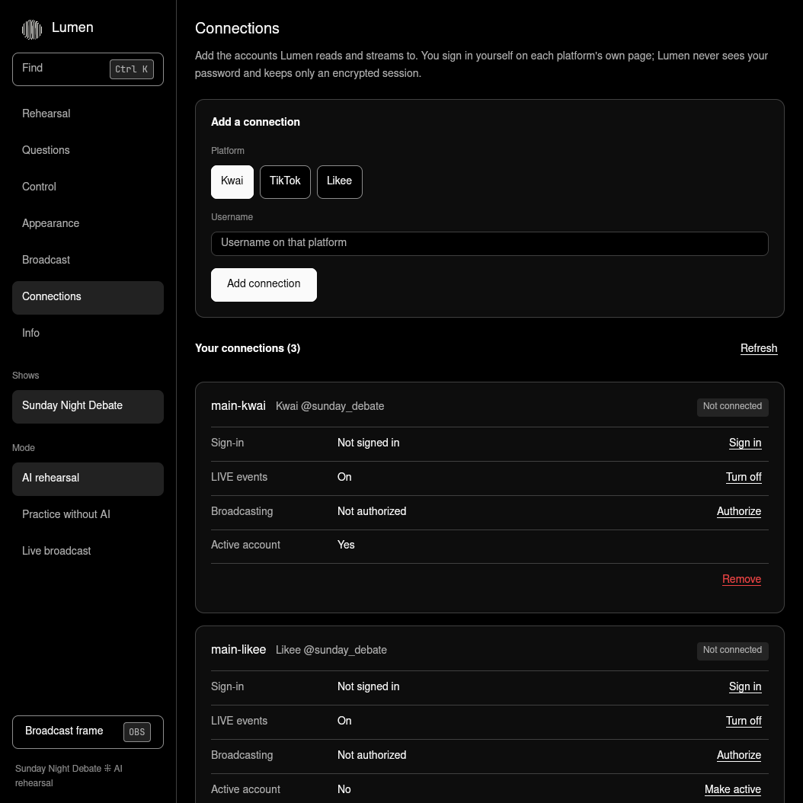

<p align="center">
  <picture>
    <source media="(prefers-color-scheme: dark)" srcset="packs/brand/lumen-mark-light.svg">
    
  </picture>
</p>

<h1 align="center">Lumen</h1>

<p align="center">
  <b>Two AI hosts debate live. Your viewers join in.</b><br>
  Name your show, pick a question, and stream it to TikTok, Kwai and Likee.
</p>

<p align="center">
  <a href="https://github.com/OnurByte/Lumen/releases/latest"><b>Download</b></a> ⁜ Linux and macOS
</p>

<p align="center"></p>

## Install

Open **Terminal** and paste:

```sh
curl -fsSL https://raw.githubusercontent.com/OnurByte/Lumen/main/install.sh | sh
```

Then open **Lumen** from your apps. A short guide helps you set up your first show.

**Updating:** Lumen tells you when a new version is out. Choose **Install update** on the **Info** page, or run `lumen update`.

## How it works

1. **Name your show.** It's yours: call it anything, and change it whenever you like.
2. **Write a question.** Your two hosts take opposite sides and argue it out.
3. **Rehearse.** Watch the whole show privately. Nothing goes live until you say so.
4. **Connect your accounts.** Sign in on each platform's own page. Lumen never sees your password.
5. **Go live.** Your hosts debate on screen and answer what viewers type in chat.

<p align="center"></p>

## What you can do

| | |
| --- | --- |
| **Run many accounts at once** | Connect as many TikTok, Kwai and Likee accounts as you want |
| **Read one chat** | Comments from every account arrive in one place, with spam and abuse filtered out |
| **Stream to several places** | Send one show to all your chosen accounts together. If one fails, the others carry on |
| **Make it look like yours** | Change colours, fonts and backgrounds, and see it instantly |
| **Stay in control** | Skip a question, pass the floor, or stop everything with one button |

Press **Ctrl K** (**⌘ K** on Mac) to find anything.

## What you need

| To | You need |
| --- | --- |
| Practise | Nothing else. Choose **Practice without AI** |
| Use AI hosts | [Codex](https://github.com/openai/codex), signed in to your ChatGPT account |
| Stream | [OBS Studio](https://obsproject.com), plus permission to go live on your account |

Going live is up to each platform. Kwai, for example, asks for 500 followers and an approved LIVE application. Some features are newer than others: [see what has been tested](docs/platforms.md).

---

<details>
<summary><b>Command line</b></summary>

```sh
lumen                     # open the app
lumen rehearse --scripted # practise without AI
lumen shows               # list your shows
lumen status              # see what is running
lumen update              # install the latest version (--rollback undoes it)
lumen info                # version and folders
```

Accounts and streaming: `lumen-live --help`.

</details>

<details>
<summary><b>Privacy and safety</b></summary>

- Your shows and sign-ins stay on your computer, and sign-ins are encrypted. Only the debate text goes to the AI you choose.
- You log in on the platform's own page, so Lumen never handles your password.
- Reading a chat never gives Lumen permission to stream. You authorize each account yourself.
- Hosts are fictional characters and say so if a viewer asks.

</details>

<details>
<summary><b>Build from source</b></summary>

You need [Rust](https://rustup.rs). Then, inside this folder:

```sh
sh install.sh
```

Remove Lumen with `sh install.sh --uninstall`. Your shows stay unless you add `LUMEN_PURGE=1`.

More: [technical reference](docs/reference.md), [platform status](docs/platforms.md), [brand](brand.md).

</details>
